<div align="center">

```
████████╗███████╗██████╗ ███╗   ███╗██╗███╗   ██╗ █████╗ ██╗         ██████╗ ██████╗  ██████╗
╚══██╔══╝██╔════╝██╔══██╗████╗ ████║██║████╗  ██║██╔══██╗██║         ██╔══██╗██╔══██╗██╔════╝
   ██║   █████╗  ██████╔╝██╔████╔██║██║██╔██╗ ██║███████║██║         ██████╔╝██████╔╝██║  ███╗
   ██║   ██╔══╝  ██╔══██╗██║╚██╔╝██║██║██║╚██╗██║██╔══██║██║         ██╔══██╗██╔═══╝ ██║   ██║
   ██║   ███████╗██║  ██║██║ ╚═╝ ██║██║██║ ╚████║██║  ██║███████╗    ██║  ██║██║     ╚██████╔╝
   ╚═╝   ╚══════╝╚═╝  ╚═╝╚═╝     ╚═╝╚═╝╚═╝  ╚═══╝╚═╝  ╚═╝╚══════╝    ╚═╝  ╚═╝╚═╝      ╚═════╝
```

### ⚔️ Terminal-RPG — an open‑world RPG that lives in your terminal ⚔️

**Five continents. Three castles. One ancient dragon. Zero graphics card required.**


</div>

---

Vaeltharion the Ashen has woken beneath the Iron Peaks. Cities burn, cults whisper in the
dark, and a lost kingdom's treasure waits to be found. You start as a nobody with
**100 gold, two potions and one God Potion**. Where you end up is up to you.

Pick a class and choose a story. Then sail between continents, crawl dungeons, mine ore,
recruit a party, build a base, found a clan, and *awaken* your class into its legendary form.

## ✨ Features

| | |
|---|---|
| 🗺️ **Huge procedural world** | A 320×120 archipelago with 5 continents, roads, rivers, ports and fog of war. Every new game is a new map. |
| 🏘️ **Walkable towns & ports** | Every city and port is a hand-crafted-feeling ASCII town: walk the streets, enter shops, inns, taverns and guilds, talk to townsfolk, and watch out for thieves and cutthroats in dark alleys. Day and night change who is out. |
| 🏰 **Three castle kingdoms** | **Valdmere**, the grey-and-white magic capital with purple banners and a dignified royal court · **Duskthorn Citadel**, a demon fortress where you choose a *pact* or *war* · **Sunspire Kasbah**, a laid-back desert palace with very sharp teeth. |
| 👑 **4 long main stories** | *The Dragon's Curse*, *The Shadow Conspiracy*, *The Lost Kingdom* and the new kingdom story *The Crown's Plea*, each 13–15 chapters over 3 acts, with choices, twists and epilogues. Plus 16 side stories. |
| 🧭 **53 places to discover** | Watchtowers that reveal the map, shrines with permanent blessings, bandit camps, a bandit king's hideout, haunted graveyards, wizard towers, obelisk teleport network, lighthouses, frozen shipwrecks, hidden caves and more. |
| ⚔️ **Tactical boss fights** | Bosses telegraph their next move, have shields you can **Break**, charge big attacks, change phases, summon adds and enrage. Story / Normal / Hard difficulty. |
| 🧙 **10 classes** | Swordsman, Mage, Rogue, Tank, Healer. Each one **awakens** into a stronger form with new skills. |
| 👥 **42 companions** | Common to legendary recruits (and ultra-rare *Starborn* variants) found in taverns, on the road, in dungeons and castles. Loyalty, gear, passives, and full customisation: rename them, give them titles and colours. |
| 🎒 **277 items with ASCII icons** | Five rarities, random affixes, set gear, legendary uniques. Type `?` + number in any list to inspect an item's icon card. 86 crafting recipes. |
| 🎨 **Character customisation** | 4 styles per class, each with its own colours and a real perk. Golden **legendary skins** come from epic quests. |
| 🏠 **Player bases & clans** | Build a home on each continent, found a clan and earn income every day. |
| ⛏️ **Mining, crafting, trading** | Mine ore, craft gear, barter with travelling merchants. |
| 💾 **Safe saves** | 5 save slots, autosave, **Continue** from the main menu. Saves from older versions keep working. |
| 🌍 **20 languages** | EN · DE · FR · ES · PT · IT · RU · PL · NL · SV · JA · ZH · KO · AR · TR · CS · HU · RO · FI · NO |

## 📸 Screenshots

<p align="center">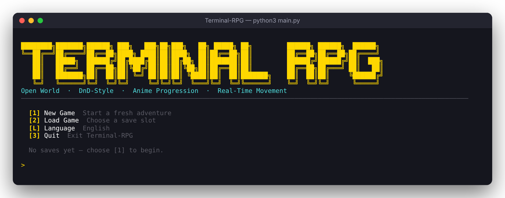 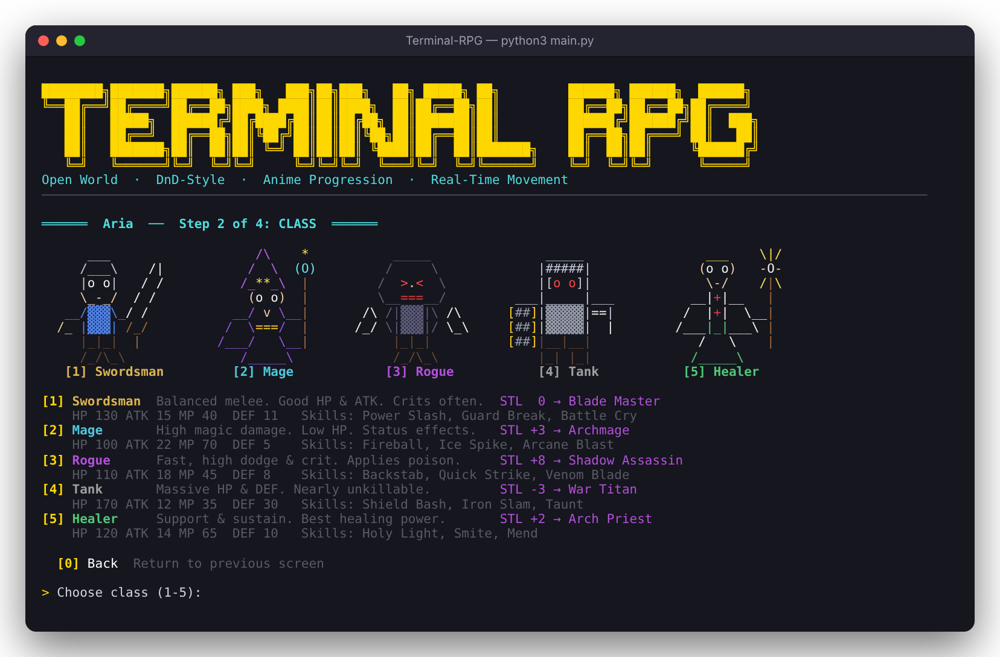</p>

**Walk through every town**: shops, guilds, taverns and townsfolk, all on foot.
<p align="center">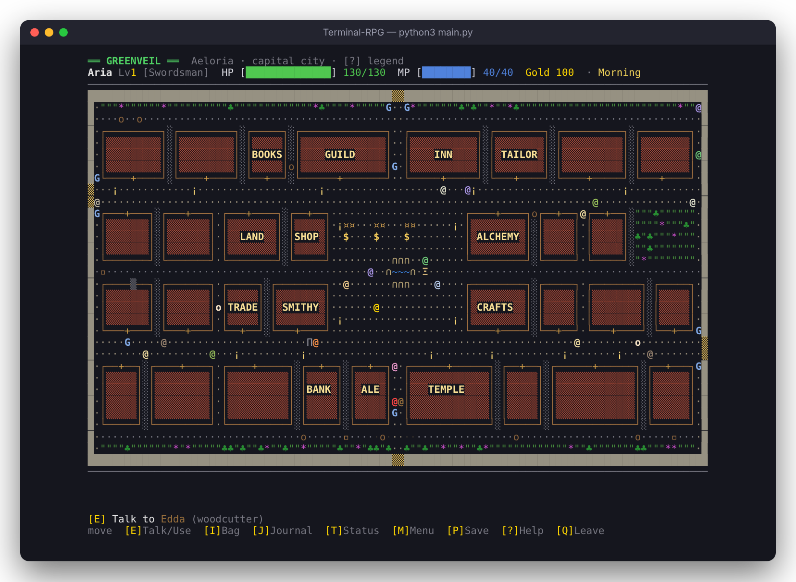</p>

**Valdmere, the royal city**, and the throne room of Castle Lumeris.
<p align="center">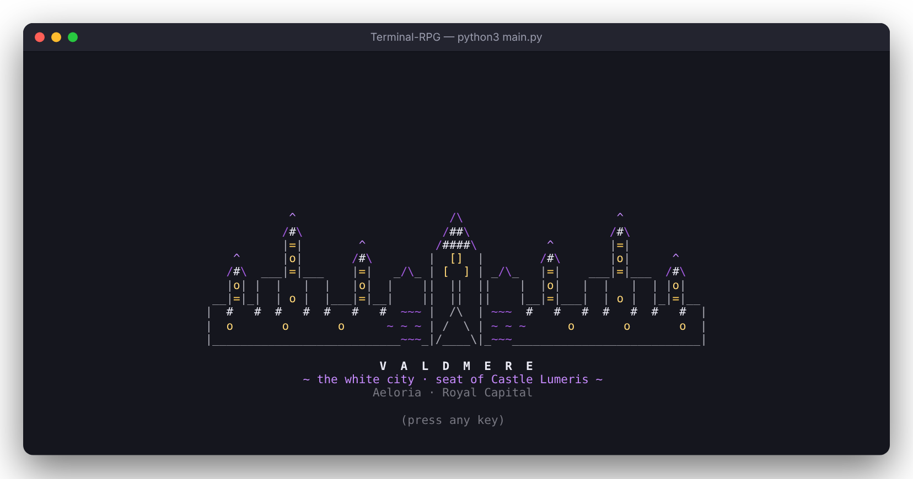</p>
<p align="center">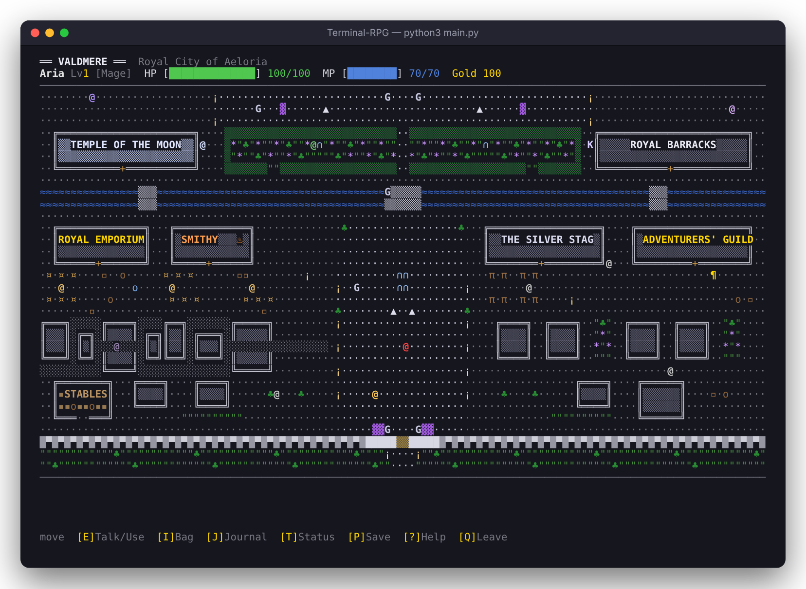 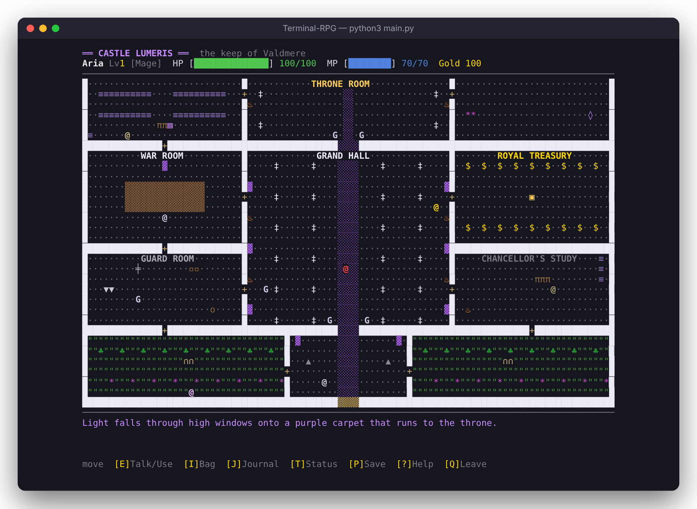</p>

**Boss fights you can read**: intents, shields, phases and summoned adds.
<p align="center">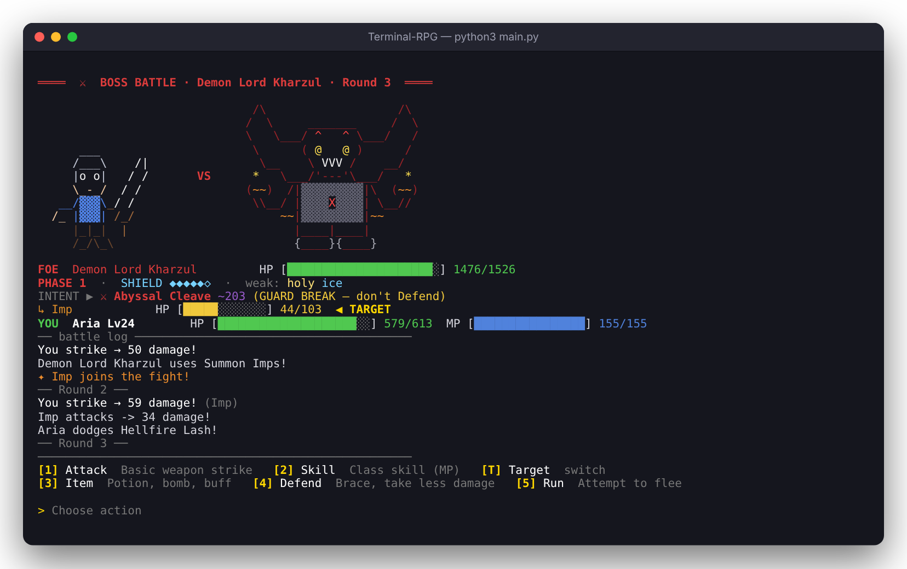</p>

<p align="center">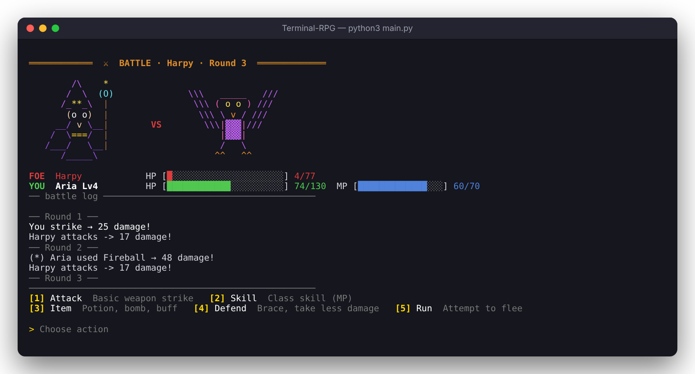 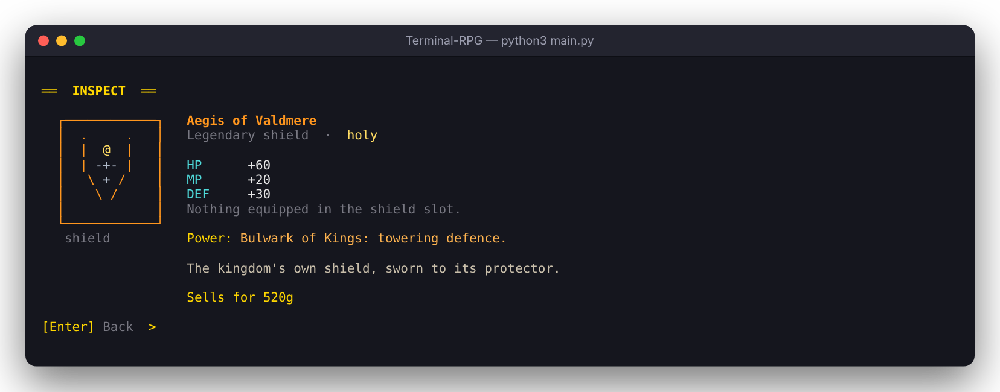</p>

**The open world and its dungeons.**
<p align="center">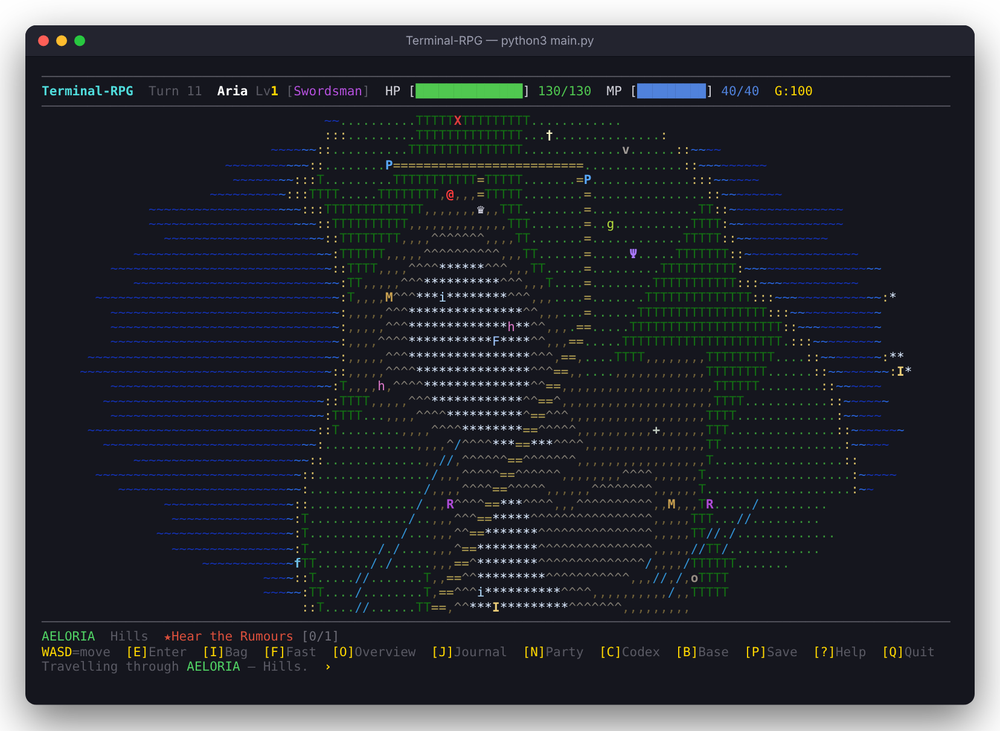</p>
<p align="center">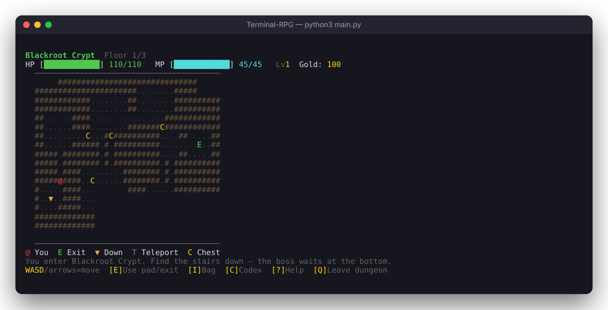 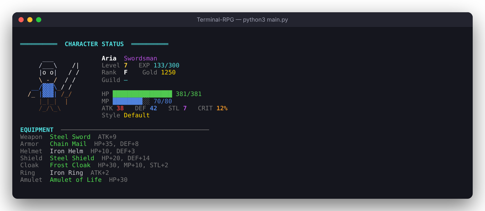</p>
<p align="center">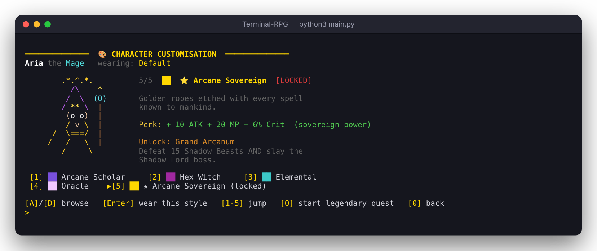</p>

<sub>Screenshots are captured from the real game. Regenerate them with `python3 tools/screenshots.py` (needs `pip install pyte` and Node + Playwright; the game itself needs nothing).</sub>

---

## 🚀 Installation, step by step

Terminal-RPG needs **only Python 3.8 or newer**. No extra packages, no game engine.

### 🪟 Windows

1. **Install Python** (skip if you already have it)
   - Go to <https://www.python.org/downloads/> and click the big yellow **Download Python** button.
   - Run the installer and **tick ✅ "Add python.exe to PATH"** at the bottom of the first screen.
   - Click **Install Now**.
2. **Download the game**
   - On this GitHub page click the green **`<> Code`** button, then **Download ZIP**.
   - Right-click the ZIP, choose **Extract All…**, and pick a folder (for example your Desktop).
3. **Check your setup** (optional): double-click **`install.bat`**. It confirms Python is ready.
4. **Play!** Double-click **`play.bat`**. 🎉

> 💡 **Tip:** the game looks best in **Windows Terminal** (preinstalled on Windows 11, free in the
> Microsoft Store for Windows 10). Make the window big (at least **100 × 34**) to see the
> combat sprites. To run it from a terminal instead, open the game folder and type `py main.py`.

### 🍎 macOS

1. **Install Python**: download it from <https://www.python.org/downloads/>, or with Homebrew run `brew install python`.
2. **Get the game**: download the ZIP from this page and unzip it, or clone it:
   ```bash
   git clone https://github.com/tristankayser/terminal-rpg.git
   cd terminal-rpg
   ```
3. **Play:**
   ```bash
   ./play.sh          # or: python3 main.py
   ```
   If you get a "permission denied" message, run `chmod +x play.sh install.sh` once.

### 🐧 Linux (and WSL)

```bash
sudo apt install python3 git        # Debian/Ubuntu — use your distro's package manager
git clone https://github.com/tristankayser/terminal-rpg.git
cd terminal-rpg
./play.sh                            # or: python3 main.py
```

### 🔄 Updating

Download the newest ZIP and copy your **`saves/`** folder into it, or just run `git pull`.
Your saves always live in the `saves/` folder next to the game.

---

## 🎮 Your first adventure

1. **New Game.** Enter a name, pick a class, choose WASD or 8‑direction movement, and pick a main story
   (pick *The Crown's Plea* to be hired by the Kingdom of Valdmere; the kingdom is always on the map either way).
2. **Visit the town next to you.** Walk onto the `P` and press **E**. You arrive at the gate of a walkable town.
   - Walk into a door (`+`) to enter: 🛒 **Shop**, 🍺 **Tavern** (recruit companions), 📜 **Guild** (quests), 🛏️ **Inn**.
   - Press **E** next to people to talk. The townsfolk know things… *(it may even advance your story)*.
   - Dark alleys hide thieves. Press **M** for the classic town menu, **Q** to leave.
3. **Explore.** Monsters roam as letters on the map. Fight them or sneak past.
4. **Hit a dungeon `X`.** Three floors deep with a boss at the bottom. Bring potions!
5. **Level up, gear up, sail away.** Ports `H` have ships to the other four continents.
6. **Awaken your class.** Start the class quest at a Quest Board and finish it. Then awaken at the Adventurers Guild.

> Press **`?`** on the map any time for help, **`J`** for your quest journal, and **`C`** for the
> encyclopedia. It includes a full in-game guide, a bestiary, every recipe, and where to farm materials.

## ⌨️ Controls

### World map
| Key | Action | | Key | Action |
|---|---|---|---|---|
| `W A S D` / arrows | Move | | `I` | Quick bag (use / equip) |
| `1`–`9` | Move incl. diagonals *(8‑dir mode)* | | `J` | Quest journal |
| `E` | Enter town, dungeon, mine, ruins / board ship | | `N` | Party & clan |
| `F` | Fast travel (same continent) | | `B` | Build / enter your base |
| `O` | World overview | | `C` | Encyclopedia & game guide |
| `M` | Discovered places | | `P` | Save game |
| `?` | Help (+ switch movement mode) | | `Q` / `Esc` | Quit (with save prompt) |

### Towns, castles & structures
| Key | Action |
|---|---|
| `W A S D` / arrows | Walk (walk into doors to enter, into people to talk) |
| `E` | Talk / use what's next to you |
| `I` · `J` · `T` | Bag · Journal · Status |
| `M` | Classic town menu (towns) |
| `P` · `?` · `Q` | Save · Help & legend · Leave |

### Combat (one key per turn)
| Key | Action |
|---|---|
| `1` | ⚔️ Attack |
| `2` | ✨ Skill: costs MP. If you're short, the rest is paid in HP (it can never kill you) |
| `3` | 🧪 Item: potions, antidotes, Strength Draught, 💣 Fire Bomb, 💨 Smoke Bomb (guaranteed escape) |
| `4` | 🛡️ Defend: brace and take much less damage |
| `5` | 🏃 Flee (not possible against bosses) |
| `T` | 🎯 Switch target when a boss has summoned adds (free action) |

Watch the boss's **INTENT** line: defend against charged and guard-break moves, hit its weakness to
break its **SHIELD**, then unload while it's stunned.

### Dungeons
Walk around to explore. Step on `▼` to go deeper and `▲` to go back up. Stand on a teleport pad `T`
and press **E** to warp out. Walk into `B` to challenge the boss. Press **Q** twice to leave.

## 🧙 Classes

| Class | Playstyle | Awakens into |
|---|---|---|
| ⚔️ **Swordsman** | Balanced fighter, frequent crits | **Blade Master** |
| 🔮 **Mage** | Huge spell damage, burns and poisons, fragile | **Archmage** |
| 🗡️ **Rogue** | Fast, sneaky, high dodge and crit, poison blades | **Shadow Assassin** |
| 🛡️ **Tank** | Massive HP and DEF, nearly unkillable | **War Titan** |
| ✚ **Healer** | Strong self-healing and regeneration | **Arch Priest** |

Every class has **4 styles** in the town's Customise menu. Each one changes your colours and gives a
perk (ATK, DEF, crit, stealth, HP, MP, potion power or extra gold). Finish a class's **legendary quest**
to unlock its golden skin with a crown and a big bonus.

## 🌍 The world

| Continent | Feel | Danger |
|---|---|---|
| 🌲 **Aeloria** | Forests and plains, the starting continent | ★☆☆☆ |
| 🏝️ **South Isles** | Tropical islands | ★★☆☆ |
| ⛰️ **Ironspire** | Mountains, mines, and the dragon's lair | ★★★☆ |
| 🏜️ **Ash Sands** | Desert of wyrms, scorpions and raiders | ★★★☆ |
| ❄️ **Frostheim** | Frozen north, the hardest continent | ★★★★ |

## 💡 Tips

- 🧪 **Never enter a dungeon without potions.** Bosses can't be fled from.
- 🥷 **Stealth wins fights before they start.** Rogues, cloaks and rogue companions raise it.
- 🏠 **Rest at an inn or your base.** It heals you fully and passes a day, so your clan earns gold.
- 🏆 **Build a Trophy Wall** in your base. Boss trophies become permanent ATK/DEF bonuses.
- ✨ **God Potions are precious.** They revive you automatically. Without one, defeat sends you to the
  nearest city and costs 10% of your gold.
- 💾 The game **autosaves** every 30 steps and after every town or dungeon visit. **Continue** on the
  main menu loads your latest save.

## 🛠️ Troubleshooting

| Problem | Fix |
|---|---|
| `python` is not recognized | Reinstall Python and tick **Add python.exe to PATH**, or use `py main.py` on Windows. |
| Strange symbols like `[38;2;…` | Your terminal doesn't support colours. Use **Windows Terminal**, or any modern terminal on macOS/Linux. |
| Combat sprites aren't shown | Make the terminal window bigger (at least 32 lines tall). |
| The game crashed | Your progress was autosaved. Choose **Continue**. Details are in `crash.log`; please open an issue and attach it. |

## 📁 Project structure

<details>
<summary>Click to expand</summary>

| File | Purpose |
|---|---|
| `main.py` | Launcher, main menu, character creation, world loop, crash-safe autosave |
| `game_world.py` | Procedural world map, movement, ships, ruins, fast travel |
| `game_systems.py` | Combat engine, towns, shops, quests, crafting |
| `game_dungeon.py` | Multi-floor dungeons with bosses, chests and fog of war |
| `game_player.py` | Player stats, levelling, inventory, equipment, quick bag |
| `game_art.py` | Colour ASCII sprites for heroes, monsters and bosses |
| `game_customise.py` | Styles, legendary skins and legendary quests |
| `game_enemies.py` | Monsters and bosses (phases, shields, intents, difficulty) |
| `game_map_enemies.py` | Roaming overworld monsters (patrol and chase AI) |
| `game_scene.py` | Walkable-map engine used by towns, castles and structures |
| `game_towns.py` | Walkable cities and ports |
| `game_capital.py` · `game_castles.py` | Valdmere, Duskthorn Citadel, Sunspire Kasbah and *The Crown's Plea* |
| `game_structures.py` | 53 explorable world structures |
| `game_party.py` · `game_recruits.py` | Companions (42), recruiting, loyalty and clans |
| `game_stories.py` · `game_story_data.py` | Story engine, main stories, side stories and epilogues |
| `game_icons.py` | ASCII item icons and inspect cards |
| `game_base.py` | Player bases and the workshop |
| `game_items.py` | 277 items, rarities, affixes, skills, status effects, loot and recipes |
| `game_mining.py` · `game_trading.py` · `game_sell.py` | Mines, barter and selling |
| `game_codex.py` | In-game encyclopedia and guide |
| `game_saves.py` | Save slots and autosave |
| `game_lang.py` | 20-language translations |
| `game_term.py` · `game_input.py` | Terminal drawing and raw keyboard input |

</details>

---

<div align="center">

**Ready, adventurer? The dragon won't slay itself.** 🐉

`play.bat` · `./play.sh` · `python main.py`

</div>
